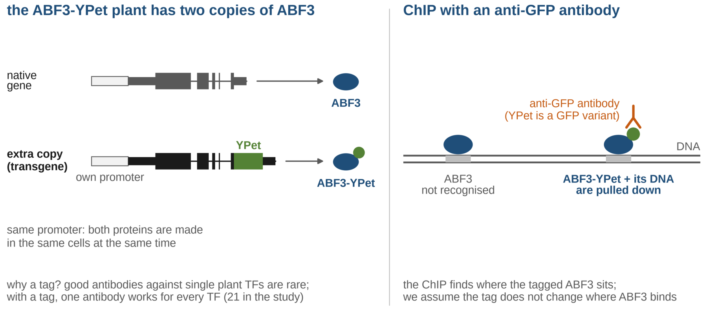
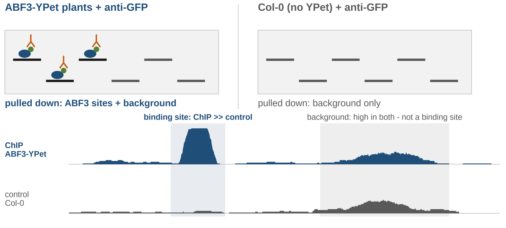
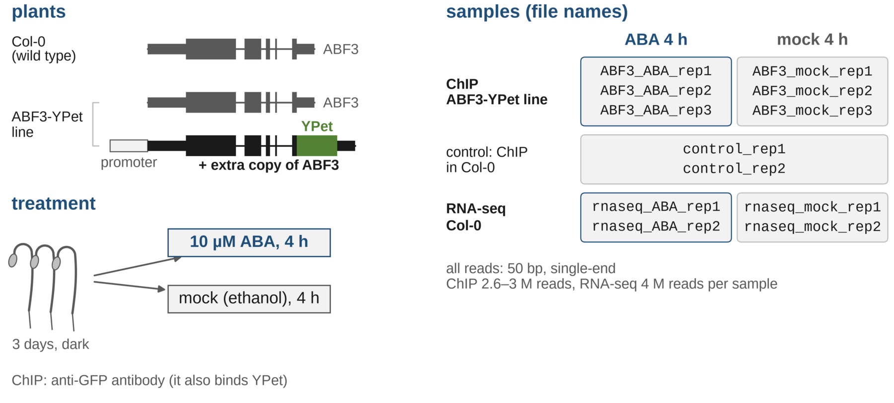
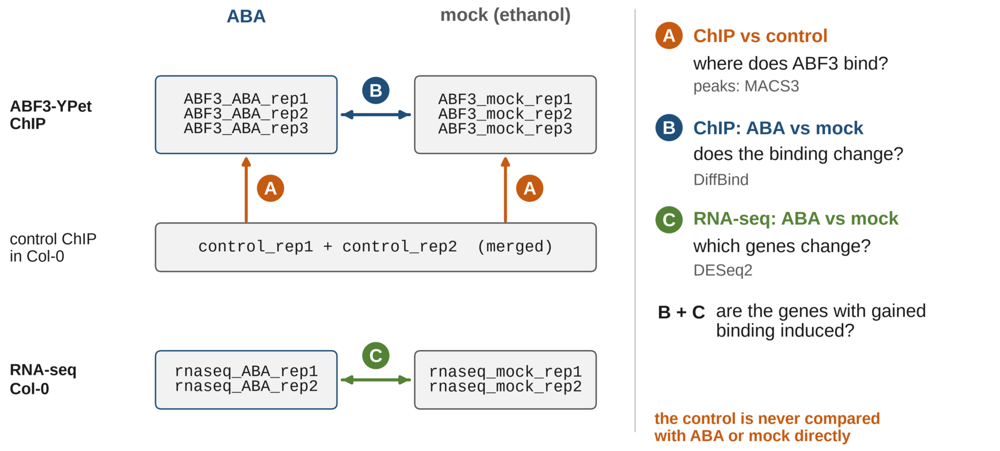

# ChIP-seq with a coding agent - how does ABF3 respond to abscisic acid?

This is an alternative version of the
[ABF3 ChIP-seq exercise](./chip_seq_abf3.md). The data and the questions are
the same, but this time **you do not type the commands**. You will:

1. read the description of the experiment and the data,
2. write an **analysis plan** and discuss it with the teacher,
3. let a **coding agent** ([opencode](https://opencode.ai)) run the analysis
   step by step,
4. **check** what the agent did and **interpret** the results yourself.

The agent is a language model that can run commands in your terminal. It is
fast, but it makes mistakes, and it reports them with the same confidence as
correct results. We use a free model, which is weaker than the best
commercial ones, so it needs clear and detailed instructions. What you learn:
how to describe a bioinformatics task precisely, how to steer an agent, and
how to check its work.

> The free model runs on an external server. Your prompts, the commands and
> their outputs are sent there and may be used for training the model. Do not
> put any personal or confidential data into the prompts.

Contents:

- [The experiment](#the-experiment)
- [Installation and data](#installation-and-data)
- [Step 1 - Write the analysis plan](#step-1---write-the-analysis-plan)
- [Step 2 - First contact with the agent](#step-2---first-contact-with-the-agent)
- [Step 3 - Run the analysis step by step](#step-3---run-the-analysis-step-by-step)
- [Step 4 - Check and interpret the results](#step-4---check-and-interpret-the-results)
- [What to hand in](#what-to-hand-in)

## The experiment

Read this part carefully - you cannot write a good plan (and you cannot
check the agent) unless you know exactly what each sample is and what is
compared with what.

### The biological question

The plant hormone **abscisic acid (ABA)** accumulates in plants exposed to
drought, salt or cold and switches on thousands of stress-response genes.
Part of this response are the **ABFs** (ABRE-binding factors), transcription
factors of the bZIP family. They bind the **ABA-responsive element (ABRE)**, a
short DNA motif with the core `ACGTG`, in the promoters of their target genes.
Without ABA the ABFs are inactive; ABA activates protein kinases that
phosphorylate them.

The question of this exercise: **where in the genome does ABF3 bind, and does
ABA change it?** Does ABF3 find new binding sites after ABA, or does it bind
more strongly to sites where it already was? And are the genes near these
sites switched on?

Data: [Song et al. 2016, *Science* 354: aag1550](https://doi.org/10.1126/science.aag1550),
who studied 21 ABA-related transcription factors this way.

### The ABF3-YPet plants - how to pull down ABF3

ChIP needs an antibody that recognises the protein of interest. Good
antibodies against single plant transcription factors are rarely available
(and the authors studied 21 of them). So they used a **tag** instead: they
made transgenic *Arabidopsis* plants with an **extra copy of the ABF3 gene**,
in which the coding sequence of **YPet** (a yellow fluorescent protein, a
variant of GFP) is attached to the end of the ABF3 coding sequence. The extra
copy is the whole genomic ABF3 gene with its own promoter, so the tagged
protein is made in the same cells and at the same time as the normal one.



The ABF3-YPet plant therefore has both: the normal ABF3 and the tagged
ABF3-YPet. The **anti-GFP antibody** recognises YPet, so it pulls down only
the tagged ABF3 together with the DNA it is bound to. We assume that the tag
does not change where ABF3 binds.

### The control - what does the antibody pull down without a target?

ChIP never gives pure binding sites. Some DNA sticks to the beads or the
antibody, some regions break more easily into fragments, some are present in
many copies or map badly. All of this gives reads that have nothing to do
with ABF3. To recognise this **background**, the authors did the same anti-GFP
ChIP in **wild-type plants (Col-0)**, which have no YPet at all - same
antibody, same procedure, but nothing to recognise. A region with many reads
in the ABF3-YPet ChIP **and** in the control is not a binding site; a binding
site has many more reads in the ABF3-YPet ChIP than in the control.



The coverage tracks in the figure are a made-up example, not the exercise data.

### The treatment - ABA and mock

Seedlings were grown for 3 days in the dark and then kept for 4 hours in a
solution with 10 µM **ABA**, or in the same solution without ABA (**mock**).
ABA is dissolved in ethanol, so the mock solution contains the same amount of
ethanol. The only difference between ABA and mock is therefore ABA itself.

Each condition has independent **biological replicates** (different
batches of plants): 3 + 3 for the ChIP, 2 + 2 for the RNA-seq. Replicates tell
us how much the signal varies by chance, so that we can say whether a
difference between ABA and mock is larger than that.



### What is compared with what



| | Compared | Question | Tool |
|---|---|---|---|
| A | each ABF3-YPet ChIP replicate vs the control | Where does ABF3 bind? (binding sites = peaks) | MACS3 |
| B | 3 ABA vs 3 mock ABF3-YPet ChIP replicates, read counts in the binding sites | Is the binding stronger or weaker after ABA? | DiffBind |
| - | sequences of the sites gained after ABA vs random genome regions | Which DNA motif does ABF3 recognise there? | HOMER |
| C | 2 ABA vs 2 mock RNA-seq replicates | Which genes are induced or repressed by ABA? | salmon + DESeq2 |
| B + C | genes with gained binding vs the other genes | Are the genes with gained binding induced? | your own R script |

Note that the control is **never compared with ABA or mock directly**. It
only tells us what background looks like, so that we can find the binding
sites (A). The effect of ABA is the comparison of ABF3-YPet ChIP with ABF3-YPet
ChIP (B), and of RNA-seq with RNA-seq (C).

To make the exercise fast, the reads were reduced to 3 million (ChIP) and 4
million (RNA-seq) per sample and shortened to 50 bp.

### The files

Sequencing data - one file per row, all in `~/chipseq_abf3/data/`:

| File | Assay | Plants | Antibody | Treatment | Replicate | Reads | Read type |
|---|---|---|---|---|---|---|---|
| `ABF3_ABA_rep1.fastq.gz` | ChIP-seq | ABF3-YPet | anti-GFP | ABA 4 h | 1 | 3 M | single-end 50 bp |
| `ABF3_ABA_rep2.fastq.gz` | ChIP-seq | ABF3-YPet | anti-GFP | ABA 4 h | 2 | 3 M | single-end 50 bp |
| `ABF3_ABA_rep3.fastq.gz` | ChIP-seq | ABF3-YPet | anti-GFP | ABA 4 h | 3 | 3 M | single-end 50 bp |
| `ABF3_mock_rep1.fastq.gz` | ChIP-seq | ABF3-YPet | anti-GFP | mock 4 h | 1 | 3 M | single-end 50 bp |
| `ABF3_mock_rep2.fastq.gz` | ChIP-seq | ABF3-YPet | anti-GFP | mock 4 h | 2 | 3 M | single-end 50 bp |
| `ABF3_mock_rep3.fastq.gz` | ChIP-seq | ABF3-YPet | anti-GFP | mock 4 h | 3 | 3 M | single-end 50 bp |
| `control_rep1.fastq.gz` | ChIP-seq control | wild type (Col-0) | anti-GFP | not stated | 1 | 2.6 M | single-end 50 bp |
| `control_rep2.fastq.gz` | ChIP-seq control | wild type (Col-0) | anti-GFP | not stated | 2 | 3 M | single-end 50 bp |
| `rnaseq_ABA_rep1.fastq.gz` | RNA-seq | wild type (Col-0) | - | ABA 4 h | 1 | 4 M | single-end 50 bp |
| `rnaseq_ABA_rep2.fastq.gz` | RNA-seq | wild type (Col-0) | - | ABA 4 h | 2 | 4 M | single-end 50 bp |
| `rnaseq_mock_rep1.fastq.gz` | RNA-seq | wild type (Col-0) | - | mock 4 h | 1 | 4 M | single-end 50 bp |
| `rnaseq_mock_rep2.fastq.gz` | RNA-seq | wild type (Col-0) | - | mock 4 h | 2 | 4 M | single-end 50 bp |

Reference files:

| File | Content |
|---|---|
| `data/TAIR10_genome.fa.gz` | genome sequence (chromosomes `1`-`5`, `Mt`, `Pt`) |
| `data/TAIR10_annotation.gff3.gz` | gene annotation (for IGV) |
| `data/TAIR10_transcripts.fa.gz` | transcript sequences (for RNA-seq) |
| `~/Desktop/Bioinformatics/data/chip_seq_abf3/TAIR10_genes.bed` | protein-coding genes (BED6: chromosome, start, end, gene ID, symbol, strand) |
| `~/Desktop/Bioinformatics/data/chip_seq_abf3/TAIR10_tss.bed` | transcription start sites of the same genes |
| `~/Desktop/Bioinformatics/data/chip_seq_abf3/TAIR10_tx2gene.tsv` | transcript → gene table |

The same directory also contains the R scripts for DiffBind and DESeq2 and
reference results (`precomputed/`).

**Biological questions:**

1. Where in the genome does ABF3 bind? Close to genes?
2. Does the binding change after ABA treatment?
3. Which DNA motif is in the sites with changed binding?
4. *(optional)* Are the genes with stronger ABF3 binding also more expressed
   after ABA?

**Suggested tools:** `fastp` (read QC), `minimap2` + `samtools` (mapping),
`deeptools` (coverage tracks, profiles), `macs3` (peak calling), `DiffBind`
(differential binding, ready R script), `bedtools` (intervals, closest gene,
sequences), `homer` (motifs), IGV (you look at the data), optionally `salmon` +
`DESeq2` (RNA-seq). See the [introduction slides](./slides/chipseq_abf3_agent_intro.pdf)
(the experiment, what is compared with what, and how to read the output of each method).

## Installation and data

Do this part yourself, without the agent, **before the practical** - the
download (1.9 GB) and the conda environment take a while. The environment is
the same as in the [original exercise](./chip_seq_abf3.md#installation-and-data).

### Conda environment and data

```bash
cd ~/Desktop/Bioinformatics && git pull
conda create -n chipseq -y --override-channels -c conda-forge -c bioconda \
    fastp minimap2 samtools macs3 deeptools bedtools seqkit homer salmon \
    bioconductor-diffbind bioconductor-deseq2 bioconductor-tximport bioconductor-genomeinfodb

D=~/Desktop/Bioinformatics/data/chip_seq_abf3
bash $D/download_data.sh
```

The script downloads the reads, the genome and the annotation from
[Zenodo](https://zenodo.org/records/23984926) into `~/chipseq_abf3/data` and
checks each file with `md5sum`. You can run it again at any time: complete
files are skipped, damaged ones are downloaded again. It must end with
`All files downloaded and checked.`

### Install opencode

[opencode](https://opencode.ai) is a coding agent that runs in the terminal.
Install it with the official script (no administrator rights needed, it goes
to `~/.opencode/bin`):

```bash
curl -fsSL https://opencode.ai/install | bash
```

The script adds `~/.opencode/bin` to your `PATH` in `~/.bashrc`. Open a new
terminal (or run `source ~/.bashrc`) and check that it works:

```bash
opencode --version
opencode models | grep free
```

The second command lists the free models (e.g. `opencode/big-pickle`). They
need no account and no API key.

- `opencode: command not found` - the new `PATH` is not active yet; open a
  new terminal, or run `export PATH=~/.opencode/bin:$PATH`.
- No free model listed - check the internet connection; the list of models is
  downloaded from the opencode server.

### Prepare the working directory

Copy the instructions for the agent and the plan template into the working
directory:

```bash
D=~/Desktop/Bioinformatics/data/chip_seq_abf3
cd ~/chipseq_abf3
cp $D/agent/AGENTS.md $D/agent/opencode.json .
cp $D/agent/plan_template.md plan.md
```

- `AGENTS.md` - rules for the agent: where the data are, what it may and may
  not do, and tested settings for each tool. opencode reads it automatically
  at the start of every session. **Read it** - it tells you a lot about how
  the analysis is done.
- `opencode.json` - the model (`opencode/big-pickle`, free) and permissions:
  the agent may run commands, but asks before deleting or moving files or
  installing software.

If the free model has a different name, list the available ones with
`opencode models` and change `"model"` in `opencode.json`.

## Step 1 - Write the analysis plan

Before you start the agent, decide what the analysis should do. Open
`plan.md` and fill in:

- the biological questions you want to answer,
- the steps of the analysis; for each step its **goal, input, tool and key
  settings, output, how you check it, and what result you expect** (an
  example for the first step is in the template).

Think about the order of the steps (what needs what), which samples go into
which step (ChIP, control, RNA-seq), and what the control is used for.

**Discuss the plan with the teacher before you continue.**

<details>
<summary>💡 Hints for the plan</summary>

- A ChIP-seq analysis usually goes: reads QC → mapping → coverage tracks →
  peak calling (ChIP vs control) → look at the data → compare conditions →
  what is in the changed sites (genes, motifs).
- The two control samples can be merged into one.
- Peaks are called in each replicate separately; comparing the number of
  peaks is not enough to say that binding changed - use DiffBind.
- One step should produce something you can check: a number, a table, a
  picture.

</details>

## Step 2 - First contact with the agent

```bash
conda activate chipseq
cd ~/chipseq_abf3
opencode
```

Start opencode from the activated environment - the agent then finds all the
tools. The basics:

| Key / command | What it does |
|---|---|
| `Tab` | switch between the **build** agent (runs commands, edits files) and the **plan** agent (only reads and proposes, changes nothing) |
| `Esc` | stop the agent when it goes wrong |
| `/undo` | undo the last change of files |
| `/new` | start a new conversation (`AGENTS.md` is read again) |
| `/export` | save the conversation as Markdown |

Warm-up (in the **build** agent): ask the agent to prepare the genome for
mapping (decompress, index for samtools and minimap2), and to tell you how
many chromosomes the genome has and how long they are.

- Watch the commands it runs. Did it follow the rules from `AGENTS.md`
  (script in `scripts/`, log in `logs/`)?
- Check the chromosome lengths yourself: `cut -f 1,2 TAIR10.fa.fai`. Do they
  agree with what the agent said?

Then switch to the **plan** agent (`Tab`), paste your plan and ask the agent
to comment on it: is something missing, are the steps in the right order? Do
you agree with its comments? Do not let it change the plan without thinking.

## Step 3 - Run the analysis step by step

Switch back to the **build** agent. For each step of your plan, write one
prompt. A good prompt contains:

- **what** to do and **why** (the goal from your plan),
- **which input** files and **which output** you want,
- the **tool and settings** if they matter (the agent knows the tested
  settings from `AGENTS.md`, but you can point to them),
- **what to report** back (e.g. "a table with the number of peaks per
  sample").

A weak prompt and a good prompt:

```text
do the mapping
```

```text
Step 3 - mapping. Map the trimmed ChIP-seq reads (trimmed/, 8 samples) to
TAIR10 with minimap2 as described in AGENTS.md, sorted and indexed BAM files
in bam/. Then merge the two controls into bam/control.bam. Test on one sample
first. At the end give me a table: sample, number of reads, % mapped (from
samtools flagstat).
```

Rules for you:

- **One step at a time.** Read the agent's report before asking for the next
  step.
- **Read the script** the agent wrote (`scripts/`) for each step. Can you say
  what each command does?
- **Check one number yourself** after each step (`wc -l`, `samtools
  flagstat`, `head` of a file ...). Write the check into `plan.md`.
- When the agent goes in circles (the same error repeatedly, installing
  software, changing the plan on its own): press `Esc`, tell it exactly what is
  wrong and what to do instead. If it does not help, ask the teacher.
- If a step really fails, the reference results are in
  `~/Desktop/Bioinformatics/data/chip_seq_abf3/precomputed/` (peaks, DiffBind
  results) - tell the agent to use them and continue.

Suggested order (your plan may differ): QC → mapping and statistics →
coverage tracks (bigWig) → peak calling → profile around TSS → DiffBind →
closest genes → motifs in the gained sites → *(optional)* RNA-seq.

Mapping and peak calling of all samples take a few minutes - the agent runs
them in the background. Use the time to look at the outputs of the previous
step.

### Optional - binding vs expression: your own specification

The last question - *are the genes with stronger ABF3 binding also induced by
ABA?* - has no ready script. The agent writes it in R, from **your**
specification. Once you have the DiffBind sites with the closest genes
(`sites_closest_gene.tsv`) and the DESeq2 results (`deseq2_ABA_vs_mock.tsv`),
write the specification into `plan.md` first. Decide:

- which binding sites count - all, or only those close to a TSS (how close)?
- how you define the groups of genes: "gained binding", "unchanged binding",
  all genes (which FDR / fold change thresholds)?
- what "induced" and "repressed" means (DESeq2 `padj`, `log2FoldChange`)?
- what you want to see: a table with numbers / percentages per group, a plot
  (which one?), a statistical test (which one, comparing what)?
- a table of the individual genes with gained binding and their expression.

Give the specification to the agent and ask it to show you the R script
before running it. Check: does the script do what you specified? Take two
genes from the output table and find them in both input files yourself.

## Step 4 - Check and interpret the results

The agent cannot look at pictures or at IGV - this is your part. Answer the
questions in `answers.md` in your own words, using the numbers and pictures
you produced. Do not ask the agent to answer them.

**Reads, mapping, peaks**

- How many reads were mapped in each sample? Is there a sample that differs
  from the others?
- How many peaks were found in each sample? Compare your numbers with
  `precomputed/peaks/` (`wc -l`). If they differ, find out why.
- What fragment length did MACS3 estimate?

**Binding sites in IGV** - load `TAIR10.fa`, the annotation, bigWig files of
one ABA and one mock replicate and the control, and their peaks (see
[1.6 of the original exercise](./chip_seq_abf3.md#16-binding-sites-in-igv)).
Go to RD29B (AT5G52300), RAB18 (AT5G66400), ABI1 (AT4G26080), ACT2
(AT3G18780) and ABF3 (AT4G34000).

- Where are the peaks relative to the genes? At which genes does the binding
  increase after ABA?
- The signal over the whole ABF3 gene is huge in all ChIP samples and absent
  in the control. Is it a binding site? (How were the plants made?)

**Around genes and differential binding**

- Look at the TSS profile. Where is the maximum of the signal? Why are the
  ABA and mock curves almost the same?
- How many sites change significantly after ABA, and in which direction? Do
  the samples separate by treatment in the PCA plot (`diffbind_plots.pdf`)?
- Which genes are closest to the most significant gained sites? Look up two
  of them in [TAIR](https://www.arabidopsis.org/). Do they make sense for an
  ABA response?

**Motifs**

- What is the best de novo motif in the gained sites? Does it contain
  `ACGTG`? Which known motifs are on top, and from which TF family?

**Binding vs expression** *(optional)*

- What fraction of all genes is induced by ABA? What fraction of the genes
  with gained ABF3 binding, and with unchanged binding?
- Is gained binding a good predictor of induction? Give reasons why a gene
  with gained binding may not be induced, and why an induced gene may have no
  ABF3 binding.
- How did your choices (distance to TSS, thresholds) change the result? Try
  one other setting.

**About the agent**

- Find one claim of the agent (a number or a statement) that you checked
  yourself. Was it correct?
- Where did the agent get stuck or do something you did not ask for? How did
  you get it back on track?
- Which part of your plan turned out to be too vague for the agent? How would
  you write it next time?

## What to hand in

From `~/chipseq_abf3`:

- `plan.md` - your plan, with the checks you did after each step,
- `scripts/` - the scripts the agent wrote,
- the conversation exported with `/export`,
- `answers.md` - your answers to the questions in Step 4.
