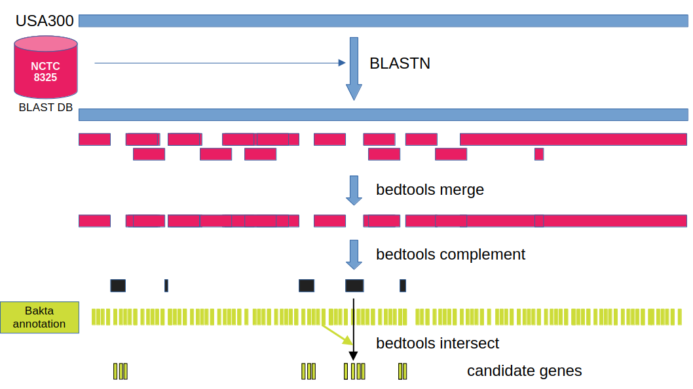
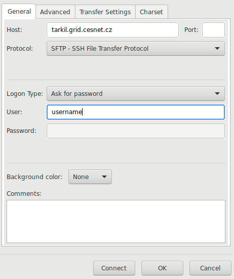

# Exercise 1 - Assembly Sanger sequence reads using Staden program

-   Available for Linux, Windows and MacOS - <http://staden.sourceforge.net/>
-   Concise tutorial : <https://bioinf.comav.upv.es/courses/intro_bioinf/_downloads/5521cd30ca085b97175a9d32ce58f517/staden_course.pdf>
-   Detailed manual : <http://bioinformatics.se/tools/staden/staden_package_manual.pdf>

## Main Staden programs:

### trev

Viewer and editor of trace files

### pregap4

Pregap is used to process raw traces. It masks low quality sequences, sequencing primers and vector sequences.

### gap4

Gap is the Genome Assembly Program – the program which actually assembles your individual fragments into long contigs. It allows you to edit the assembly, referring back to the starting traces where they are present.

## Data for assembly:

Data for assembly are located in `~/Desktop/bioinformatics/data/sanger`

# Exercise 2 - Genome Assembly from NGS data

In this exercise you'll assemble the genome of *Staphylococcus aureus* using short reads, paired-end reads, and long reads to see how method choice affects contiguity and accuracy. Your main target is the USA300 methicillin-resistant strain (MRSA). You will build de novo assemblies and assess their quality and annotate the best candidate genome. Then compare your assembly to a methicillin-susceptible strain to spot structural differences and identify candidate resistance loci.

## Part 1 - Assembly using Single End Short Reads:

### Installation of necessary programs

Using mamba:
```bash
# you will have to run it on VM as administrator
su root   # enter administrator password
mamba create -n assembly -y -c bioconda jellyfish fastx_toolkit quast samtools fastqc multiqc bowtie2 velvet hifiasm
exit  # exit from root user
conda activate assembly
```

Alternative installation using conda:

```bash
conda config --set plugins.auto_accept_tos yes
conda create -n assembly -y -c bioconda jellyfish fastx_toolkit quast samtools fastqc multiqc bowtie2 velvet hifiasm
conda activate assembly
```


### Single-end library

1.  Data

    The data you will examine is from *Staphylococcus aureus* USA300 which has a genome of around 3MB. The reads are Illumina and are unpaired, also known as single-end library. The data needed for this section can be obtained from the Sequence Read Archive (SRA). For the following example use the run data SRR022825 and SRR022823 from the SRA Sample SRS004748. The SRA experiment can be viewed by setting your browser to the URL:
    <http://www.ebi.ac.uk/ena/data/view/SRS004748>

    Create directory for assembly:

    ```bash
    cd
    mkdir ngs_assembly
    cd ngs_assembly
    ```

    Data can be obtained directly using either the wget command:

    ```bash
    wget ftp://ftp.sra.ebi.ac.uk/vol1/fastq/SRR022/SRR022825/SRR022825.fastq.gz
    wget ftp://ftp.sra.ebi.ac.uk/vol1/fastq/SRR022/SRR022823/SRR022823.fastq.gz
    ```

    Or using fastq-dump from NCBI-SRA, which is a utility for downloading data from the NCBI-SRA database:

    ```bash
    fastq-dump --gzip SRR022825
    fastq-dump --gzip SRR022823
    ```

### Quality control using FASTQC program

[FASTQ format](https://github.com/kavonrtep/bioinformatics/blob/master/docs/data_formats.md#fastq-fastq-fq-usually-gz) 

Run FASTQC program on Illumina reads:

```bash
fastqc *.fastq.gz
```

This command will create HTML reports:

-   `SRR022825_fastqc.html`
-   `SRR022823_fastqc.html`

Inspect the reports and answer:

-   What is the sequence read length?
-   How many sequences are in the single runs?
-   What is the total number of bases?
-   What is the sequencing coverage?

### Estimation of genome size:

We will use a k-mer-count-based estimation of genome size according to <http://genomescope.org>

We will use the Jellyfish program. It is a command-line program that reads FASTA and multi-FASTA files containing DNA sequences. It outputs its k-mer counts in a binary format, which can be translated into a human-readable text format using the "jellyfish dump" command (<https://github.com/gmarcais/Jellyfish>)

```bash
# jellyfish needs file in uncompressed format
zcat SRR022825.fastq.gz > SRR022825.fastq
zcat SRR022823.fastq.gz > SRR022823.fastq
# kmer counting (several minutes):
jellyfish count -C -m 21 -s 100000000 -t 2 *.fastq -o reads.jf
# create histogram:
jellyfish histo -t 2 reads.jf > reads.histo
# inspect kmer count using:
less reads.histo
# this file can also be inspected in LibreOffice Calc or MS Excel

# read.jf is binary format, kmers can be viewed using jellyfish dump command e.g.:
jellyfish dump -c reads.jf | less
```

Note: parameter `-s` is the initial hash size - it affects memory usage.

Go to <http://genomescope.org> and upload the resulting `reads.histo` file and fill in the correct parameters - **kmer size** and **read length**:

-   What is the estimated genome size?
-   What is your sequencing coverage? (*read_length* × *number_of_reads*) / *genome_size*

### Assembly

You are now ready to assemble your data with Velvet. Velvet has two main components:

-   **velveth** - used to construct, from raw read data, a dataset organized in the fashion expected by the second component, velvetg.
-   **velvetg** - the core of Velvet where the de Bruijn graph assembly is built and manipulated.

You can always get further information about the usage of both Velvet programs by typing `velvetg` or `velveth` in your terminal.

```bash
# make kmer counting
velveth run_25 25 -fastq.gz -short SRR022825.fastq.gz SRR022823.fastq.gz
# explore files in the run_25 directory

# run assembly:
velvetg run_25
```

Explanation:

-   `run_25` - assembly directory
-   `25` - hash length (kmer length)
-   `-fastq.gz` - specifies input format

Explore the run_25 directory files:

-   `directory/contigs.fa` : FASTA file of contigs longer than twice the hash length
-   `directory/stats.txt` : stats file (tab-separated) useful for determining appropriate coverage cutoff
-   `directory/LastGraph` : special formatted file with all the information on the final graph
-   `directory/velvet_asm.afg` : (if requested) AMOS compatible assembly file
-   `Log` : information about the assembly

### Genome assembly statistics:

Use **Quast** tools to assess the quality of assembly: <http://quast.sourceforge.net/quast>

Upload the file contigs.fa and run quality assessment.

-   What is the N50?
-   What is the total length of the assembly?
-   How long is the longest contig?
-   Considering the amount of input data (read length × number of reads), what is the sequencing coverage?
-   Is the total length of the genome assembly in agreement with the k-mer-based estimation of genome size?

Command line Quast:

```bash
quast run_25/contigs.fa --threads 7
```

The assembly graph can be inspected using the **Bandage** program.

From command line run:

```bash
Bandage
```

1.  Optional:

    Results from the k-mer-based analysis suggest that the sequencing coverage is more than 10x and lower frequency k-mers are likely erroneous. Excluding such k-mers can improve the assembly. We will rerun velvetg with `-cov_cutoff 6` and `-exp_cov 14` command line options.

    ```bash
    # Make a copy of previous assembly
    cp run_25/contigs.fa run_25/contigs.fa.0
    # rerun velvetg with coverage cutoff
    velvetg run_25 -cov_cutoff 6 -exp_cov 14
    ```

    The `-amos_file yes` option will export results to AMOS format.

    Compare the first and second assembly using Quast:

    ```bash
    quast run_25/contigs.fa run_25/contigs.fa.0 --threads 7
    ```

## Part 2 - Assembly using Pair-End Short Reads:

### Paired-end data and QC:

Now we will perform assembly of Illumina paired-end reads from
*Staphylococcus aureus* USA300. Using paired-end reads usually improves assembly quality because the distance between the two reads is known and this information can be used to resolve repeats during assembly. Additionally, we will use higher number of reads (coverage) which should also improve assembly quality.

1.  Download from NCBI:

    ```bash
    cd
    mkdir ngs_assembly2
    cd ngs_assembly2
    # get paired end reads
    wget ftp://ftp.sra.ebi.ac.uk/vol1/fastq/SRR022/SRR022852/SRR022852_1.fastq.gz
    wget ftp://ftp.sra.ebi.ac.uk/vol1/fastq/SRR022/SRR022852/SRR022852_2.fastq.gz
    # run fastqc program
    fastqc *.fastq.gz
    ```

### Removing low quality reads:

Some reads have low quality. We can filter low quality sequences using the fastx-toolkit program. Additionally, according to the **fastqc** report, the first base in reads is biased and needs to be removed.

```bash
zcat SRR022852_1.fastq.gz | fastx_trimmer -f 2 -o SRR022852_1_trimmed.fastq
zcat SRR022852_2.fastq.gz | fastx_trimmer -f 2 -o SRR022852_2_trimmed.fastq
# check quality again
fastqc SRR022852_1_trimmed.fastq SRR022852_2_trimmed.fastq
```

### Assembly

```bash
velveth run_25_paired 25 -fastq -shortPaired -separate SRR022852_1_trimmed.fastq SRR022852_2_trimmed.fastq
velvetg run_25_paired -ins_length 350
```

### Compare paired-end assembly with single-end assembly

- Use the **Quast** program (<http://quast.sourceforge.net/quast>) to calculate basic statistics of the assembly and compare it to the previous assembly from single-end Illumina reads:

    ```bash
    # quast can be run on multiple assemblies
    # we will compare assembly from SE reads and PE reads:
    cd
    quast ngs_assembly/run_25/contigs.fa ngs_assembly2/run_25_paired/contigs.fa -o ngs_assembly2/quast
    ```

- Use the **Bandage** program.
Bandage can visualize assembly graphs. Open the file `ngs_assembly2/run_25_paired/LastGraph` in Bandage and compare it to the previous assembly graph from single-end reads.

### Align short paired reads to assembly:

We will align original sequence reads to the resulting genome assembly so we can explore assembly quality using the IGV genomic browser. 
```bash
cd 
cd ngs_assembly2
# create database from contigs
bowtie2-build run_25_paired/contigs.fa run_25_paired/contigs.fa
# map reads to assembly : (~1min)
bowtie2 -p 8 -x run_25_paired/contigs.fa -1 SRR022852_1_trimmed.fastq -2 SRR022852_2_trimmed.fastq > SRR022852.sam
# convert SAM to BAM format (~1min):
samtools view -b SRR022852.sam > SRR022852.bam
# sorting according to position (~1min)
samtools sort SRR022852.bam > SRR022852_sorted.bam
# create index:
samtools index SRR022852_sorted.bam
```
Note all above commands can be run in single line using pipes to speed up the process and save disk space:
```bash
bowtie2 -p 8 -x run_25_paired/contigs.fa -1 SRR022852_1_trimmed.fastq -2 SRR022852_2_trimmed.fastq | samtools view -b - | samtools sort -o SRR022852_sorted.bam
samtools index SRR022852_sorted.bam
```
[SAM/BAM format](https://github.com/kavonrtep/bioinformatics/blob/master/docs/data_formats.md#sam--bam--cram--bai-for-bam-index-crai-for-cram-index)

### Visualization of assembly

[IGV program](https://github.com/kavonrtep/bioinformatics/blob/master/docs/Integrative_Genomics_Viewer.org)

Run IGV program to inspect the assembly. In IGV load the genome - select the `contigs.fa` file. Then load the read mapping from SRR022852_sorted.bam. Genome assembly is loaded using menu `Genomes -> Load Genome from File...` and the read mapping is loaded using menu `File -> Load from File...`

The manual for IGV can be found at: <http://software.broadinstitute.org/software/igv/UserGuide>

Explanation of color coding (insert size):

- Insert size: <http://software.broadinstitute.org/software/igv/interpreting_insert_size>
- Pair orientation: <http://software.broadinstitute.org/software/igv/interpreting_pair_orientations>

Inspect the beginning and end of contigs in IGV. The color coding of mapper reads can also indicate mapping of the mates to different contigs. This can indicate possible mis-assemblies or unresolved repeats.


### Analyze completeness of assembly using the BUSCO program:

BUSCO (Benchmarking Universal Single-Copy Orthologs) is a tool designed to evaluate genome assembly quality by checking for the presence of single-copy orthologs expected in nearly all genomes from a given lineage. This method offers a metric for assembly completeness by assessing the proportion of universally conserved genes found in the assembly. For genome assemblies, BUSCO identifies these essential genes and classifies them as **complete**, **duplicated**, **fragmented**, or **missing**. By comparing these results across multiple assemblies, we can gain insights into which assembly version is more complete and thus of higher quality, making it especially useful in comparative genomics and genome improvement projects.

Before running analysis, we need to specify a suitable lineage. List all available lineages in the BUSCO database:

```bash
busco --list-datasets
```

The above command will list all taxonomic groups. We need to select the one that is closest to *Staphylococcus aureus*. Go to the NCBI website (https://www.ncbi.nlm.nih.gov/) and search the Taxonomy database for *Staphylococcus aureus* and compare the NCBI taxonomy with BUSCO lineages and select the closest taxonomy group for analysis and set the `--lineage` argument accordingly.
Note - our version of BUSCO is compatible only with lineage datasets version 10. - https://busco.ezlab.org/frames/bact.htm

```bash
cd ~/ngs_assembly/run_25/
busco -i contigs.fa -o busco_output -m genome -c 5 --lineage ??????
cd ~/ngs_assembly2/run_25_paired/
busco -i contigs.fa -o busco_output -m genome -c 5 --lineage ??????
# each run will take several minutes to finish
```

Inspect the output files. Which assembly is more complete according to BUSCO statistics?

## Part 3 - Assembly using Long PacBio HIFI Reads
Before starting this part, update data in your Bioinformatics repository:

```bash
cd ~/Desktop/Bioinformatics
git pull
```


In the third part of the exercise we will perform genome assembly using long PacBio HiFi reads. The data is from *Staphylococcus aureus* USA300. The data can be downloaded from SRA run SRR11606884. PacBio HiFi reads are high-fidelity long reads with low error rates, making them suitable for complex genome assemblies.

PacBio HiFi are located in `~/Desktop/Bioinformatics/data/genome_assembly/pacbio_hifi_reads25.fastq.gz`

```bash
# create new directory for pacbio assembly
cd 
mkdir pacbio_assembly
cd pacbio_assembly
# copy pacbio reads
cp ~/Desktop/Bioinformatics/data/genome_assembly/pacbio_hifi_reads25.fastq.gz .

# Check the reads with fastqc program
fastqc pacbio_hifi_reads25.fastq.gz
```
- How many reads are in the dataset, and what is the total number of bases?
- What is the average read length?
- What is the estimated genome coverage (considering genome size of 2.8 MB)?

### Assembly using hifiasm program

We will use the hifiasm program for assembly of PacBio HiFi reads. Hifiasm is a fast and efficient assembler specifically designed for high-fidelity long reads, such as PacBio HiFi data or Oxford Nanopore reads. More information can be found at https://github.com/chhylp123/hifiasm. By default hifiasm assembler focuses on creating haplotype-resolved assemblies, which can be useful for diploid or polyploid organisms. However, for bacterial genomes, which is haploid, we can simplify the assembly process by using the `-l0` option to disable haplotype resolution.


```bash
hifiasm -f0  -o ams -t 4 -l0 pacbio_hifi_reads25.fastq.gz
```
The above command will take ~ 3 minutes to finish.
During assembly, hifiasm shows simple histogram of k-mer frequencies. From the histogram you can see the average coverage of the genome. Is this in agreement with your previous estimation of genome coverage?

The assembler will produce .gfa files from which we can extract contigs in FASTA format:

```bash
# this is command from hifiasm manual to extract contigs from gfa file
awk '/^S/{print ">"$2"\n"$3}' ams.bp.p_ctg.gfa > contigs.fa
```
Alternatively, you can inspect the assembly graph using the Bandage program by opening the file `ams.p_ctg.gfa` and export contigs in FASTA format using Bandage.

### Assembly statistics

Run Quast program to calculate assembly statistics:

```bash
quast contigs.fa --threads 4 -o quast_output
```
- How many contigs are in the assembly?
- What is the total length of the assembly?
- What is the N50 of the assembly?

Resulting assembly contains one large contig of ~2.9 MB which likely represents the complete bacterial chromosome. Are there any other contigs? What could they represent? Extract individual contigs to separate files using seqkit program:

```bash
seqkit split -i contigs.fa
````
This will create directory `contigs.fa.split` with individual contig files. 

Analyze the smaller contigs using BLASTN program against NCBI nt database (https://blast.ncbi.nlm.nih.gov/Blast.cgi) to identify their origin.

What do they represent?

### Compare hifiasm assembly with Illumina paired-end assembly 

- Use Gepard program to compare the two assemblies using dotplots
- Alternatively, you can compare the two assemblies using D-Genies online tool: https://dgenies.toulouse.inra.fr/ - on resulting dotplot from D-genies try on options "Sort contigs" and "Hide noise" 
- What are the major differences between the two assemblies according to the dotplot?

### Evaluate completeness of assembly using BUSCO program:

```bash
busco -i contigs.fa -o busco_output -m genome -c 5 --lineage bacillales
```
Compare the BUSCO statistics with previous assemblies from Illumina reads. Is the assembly from PacBio HiFi reads more complete?


### Compare USA300 assembly with reference genome of *Staphylococcus aureus* NCTC 8325 strain 
- NCTC 8325 is a well-studied laboratory strain of *Staphylococcus aureus* with a fully sequenced and annotated genome.
- USA300 strain is methicillin-resistant Staphylococcus aureus (MRSA) and is genetically distinct from other strains of Staphylococcus aureus. MRSA is responsible for several difficult-to-treat infections in humans.
- The comparison of the two genomes can provide insights into genetic variations, virulence factors, and antibiotic resistance mechanisms specific to the USA300 strain.

**Option 1** - Download reference genome from NCBI
- Go to NCBI website: https://www.ncbi.nlm.nih.gov/
- Search for *Staphylococcus aureus* NCTC 8325
- In the Taxonomy section look for available genomes
- Go to genome which is labeled as Reference
- Inspect download options and download zip file with genomic FASTA file
- extract the downloaded zip and inspect archive content
- use `md5sum` program to verify integrity of downloaded files

**Option 2** - Use the reference genome provided in the data directory
 
- The reference genome can be downloaded from NCBI at: https://www.ncbi.nlm.nih.gov/assembly/GCF_000013425.1/
- NCTC 8325 genome file is located in `~/Desktop/Bioinformatics/data/genome_assembly/GCF_000013425.1_ASM1342v1_genomic.fna`

```bash
# make copy of reference genome in pacbio_assembly directory
cp ~/Desktop/Bioinformatics/data/genome_assembly/GCF_000013425.1_ASM1342v1_genomic.fna .
```
#### Use 


Use Gepard program to compare our USA300 assembly with the reference genome using dotplots.
- What are the major differences between the two genomes, according to the dotplot?
- What is your interpretation of these differences?
- How can these differences relate to the pathogenicity of USA300 strain?

### Genome annotation with Bakta program

For genome annotation we will use the Bakta program. Bakta is a rapid and standardized annotation tool for bacterial genomes that provides consistent and comprehensive annotations by leveraging a curated database of known genes and proteins. It is designed to be user-friendly and efficient, making it suitable for both small-scale and large-scale bacterial genome projects. We will use an online version of Bakta available on Galaxy server: https://usegalaxy.eu/

- go to Galaxy server: https://usegalaxy.eu/
- upload the file `contigs.fa` to Galaxy
- search for Bakta tool
- run Bakta on the uploaded `contigs.fa` file.
   - set Optional annotation -> Keep original contig header to "yes"
   - in Selection of the output files select "CDS/sORF amino acid sequences as FASTA"
- when the job is finished, download the resulting GFF3 annotation file to `pacbio_assembly` directory - name it `Bakta_annotation.gff3`. Download also summary file - name it `Bakta_summary.csv`

<details>
<summary>💡 Does annotation run on Galaxy take too long?</summary>
If the run on galaxy runs too long, you can use annotation files provided in the data directory. 

```bash
cp ~/Desktop/Bioinformatics/data/genome_assembly/Bakta_annotation.gff3 .
cp ~/Desktop/Bioinformatics/data/genome_assembly/Bakta_summary.csv .
```
</details>

### Identification of genomic features present in USA300 assembly but absent in NCTC 8325 reference genome

We will compare two genome sequences using BLASTN program to identify genomic features present in USA300 assembly but absent in the NCTC 8325 reference genome. Complete workflow is shown in the figure below:



First we will run BLASTN of USA300 assembly contigs against NCTC 8325 genome to identify regions in USA300 genome that have significant similarity to NCTC 8325 genome.

```bash
# create BLAST database from NCTC 8325 genome
makeblastdb -in GCF_000013425.1_ASM1342v1_genomic.fna -dbtype nucl
# run BLASTN of USA300 against NCTC 8325 genome
blastn -task megablast -query contigs.fa -db GCF_000013425.1_ASM1342v1_genomic.fna -outfmt 6 -out usa300_vs_nctc8325.blastn -word_size 28 -evalue 1e-10 -num_threads 4 -perc_identity 95
```
Output will be in tabular format with columns:
1. query id
2. subject id
3. % identity
4. alignment length
5. mismatches
6. gap opens
7. q. start
8. q. end
9. s. start
10. s. end
11. evalue
12. bit score

### Create BED file from BLASTN results 

To be able to visualize BLASTN results in IGV browser, we need to convert the BLASTN output to BED format. We will filter only query id, q.start, q.end and create a BED file:

```bash
cut -f 1,7,8 usa300_vs_nctc8325.blastn > usa300_vs_nctc8325.bed
```
### Visualize BLASTN results in IGV browser

- Start IGV program and load USA300 assembly contigs as genome and load the BED file with BLASTN results as annotation track.
- Track shows regions in USA300 genome that have significant similarity to NCTC 8325 genome, blank regions represent sequences that are unique to USA300 genome.
- Load also the Bakta annotation GFF3 file as annotation track.
- Can you identify regions in USA300 genome that are not present in NCTC 8325 genome?
- Do these regions contain any genes according to Bakta annotation?

### Extract genome annotation for genes present in USA300 but absent in NCTC 8325 genome.

For manipulation with BED and GFF3 files we will use the bedtools program (https://bedtools.readthedocs.io/en/latest/content/overview.html).

First we will merge overlapping regions in the BED file using bedtools merge command (https://bedtools.readthedocs.io/en/latest/content/tools/merge.html)

```bash
# coordinates in BED file must be sorted before using merge command
sort -k1,1 -k2,2n usa300_vs_nctc8325.bed > usa300_vs_nctc8325.sorted.bed
# inspect the sorted file
less usa300_vs_nctc8325.sorted.bed
bedtools merge -i usa300_vs_nctc8325.sorted.bed > usa300_vs_nctc8325.merged.bed
# inspect the resulting file
less usa300_vs_nctc8325.merged.bed
````

Now we will create complement of the merged BED file using bedtools complement command (https://bedtools.readthedocs.io/en/latest/content/tools/complement.html). The complement will represent regions in USA300 genome that are not present in NCTC 8325 genome. Input for complement command is a BED file and also a genome file with lengths of individual contigs. We can create the genome file from the USA300 assembly FASTA file using `faidx` command from samtools program. Note, when you open the genome in IGV browser, this file is also created automatically by IGV.

```bash
seqkit faidx contigs.fa
# this will create contigs.fa.fai file with contig lengths
# inspect the file
cat contigs.fa.fai
bedtools complement -i usa300_vs_nctc8325.merged.bed -g contigs.fa.fai > usa300_unique_regions.bed
````


Now we can extract genome annotation for genes present in USA300 but absent in NCTC 8325 genome using bedtools intersect command (https://bedtools.readthedocs.io/en/latest/content/tools/intersect.html)

```bash
# Bakta_annotation.gff3 file contains also sequence lines at the end of the file, we need to remove them first
# keep only lines starting with # or with contig names (assumed to start with "ptg")
grep -E '^(#|ptg)' Bakta_annotation.gff3 > Bakta_annotation_clean.gff3

bedtools intersect -f 1 -a Bakta_annotation_clean.gff3 -b usa300_unique_regions.bed > usa300_unique_genes.gff3
```
Note: option -f 1 ensures that only features completely contained within the unique regions are selected.


Count number of genes (CDS features) annotated by Prodigal program in the resulting GFF3 file:

```bash
grep -c "Prodigal" usa300_unique_genes.gff3
```
Bakta program does structural annotation of genes using Prodigal program. Functional annotation is done using similarity to known proteins from various databases. Each protein can have assigned Id, Name, Gene ontology terms, Enzyme codes, etc. We can search for specific functional annotation in the resulting GFF3 file using grep command. For example, to search for genes related to antibiotic resistance, we can search for Gene Ontology term `GO:0046677` which corresponds to "response to antibiotic" (https://amigo.geneontology.org/amigo/term/GO:0046677)

```bash
grep "GO:0046677" usa300_unique_genes.gff3 > usa300_unique_genes_go_0046677.gff3
less -S usa300_unique_genes_go_0046677.gff3
```
- How many genes possibly related to antibiotic resistance are present in USA300 genome but absent in NCTC 8325 genome?
- Are all these genes on bacterial chromosome or are some located on plasmids (check contig names in GFF3 file)?

<details>
<summary>💡 Hint </summary>

- there are genes located on plasmid but these are not related to methicillin resistance but to resistance to other antibiotic
- for methicillin resistance look for gene with Name "mecA", "mecR1"
- they are located on chromosome  in uniq locus in `ptg00002l:2824915-2836633`
- Not all annotated genes have Gene Ontology terms assigned, so searching by GO terms may miss some relevant genes. More detailed analysis of gene functions may require additional annotation or literature review.
</details>

# Exercise 3 - Genome assembly of MRSA from Illumina and Nanopore reads

In this exercise you will assemble the genome of the methicillin-resistant
*Staphylococcus aureus* strain USA300 twice - from short Illumina reads and
from long Oxford Nanopore (ONT) reads - and compare the results. All
computations take seconds to a few minutes, so focus on the **interpretation of
the outputs**: what the numbers and plots tell you about the reads, the genome
and the quality of the assembly.

You have Illumina NovaSeq (2×150 bp) and Oxford Nanopore (R10.4.1) reads from a
USA300 isolate. The data contain several problems typical of real sequencing
runs. A closely related
genome - the published genome of USA300 strain FPR3757 - is available, so we
can check what the assemblers got right and what they missed. But be careful:
our isolate is not necessarily identical to the published strain.

Introduction slides - the pipeline, read QC, k-mer spectrum, assembly graphs, QUAST, Flye
output, read pairs in IGV, BUSCO and MRSA:
[assembly_intro.pdf](./slides/assembly_intro.pdf)

Data are in `~/Desktop/Bioinformatics/data/genome_assembly2/`:

| File | Content |
|---|---|
| `usa300_R1.fastq.gz`, `usa300_R2.fastq.gz` | Illumina paired-end reads 2×150 bp |
| `usa300_ont.fastq.gz` | Oxford Nanopore reads |
| `usa300_FPR3757_reference.fna.gz`, `usa300_FPR3757_reference.gff.gz` | published genome and annotation of USA300 FPR3757, used **only** for evaluation of the assemblies (Part 2) |
| `precomputed/` | results of the long-running steps, use them only if something fails |

## Installation of the conda environments

Two environments are needed (BUSCO conflicts with some of the other programs).
The installation takes a few minutes:

```bash
conda create -n assembly2 -y --override-channels -c conda-forge -c bioconda \
    python=3.11 fastp kmer-jellyfish megahit flye quast minimap2 samtools seqkit bandage blast bedtools
conda create -n busco -y --override-channels -c conda-forge -c bioconda busco
```

> Note: the k-mer counter Jellyfish is in the package `kmer-jellyfish`. The
> package `jellyfish` is an unrelated Python library.

Prepare a working directory:

```bash
mkdir -p ~/assembly2
cd ~/assembly2
cp ~/Desktop/Bioinformatics/data/genome_assembly2/*.gz .
ls -lh
conda activate assembly2
```

## Part 1 - Assembly from short Illumina reads

### Quality control and trimming with fastp

`fastp` checks the quality of the reads and removes adapters and low-quality
ends in one step. The result is an HTML report with statistics before and after
filtering.

```bash
fastp -i usa300_R1.fastq.gz -I usa300_R2.fastq.gz \
      -o trimmed_R1.fastq.gz -O trimmed_R2.fastq.gz \
      --detect_adapter_for_pe -w 4 -h fastp.html -j fastp.json
firefox fastp.html
```

Questions:
- How many read pairs are in the dataset? What is the total number of bases?
  What is the approximate sequencing coverage, if the genome size of *S. aureus*
  is about 2.9 Mb?
- What fraction of bases has quality ≥ Q30? What does Q30 mean in terms of the
  probability of an error?
- Which adapter sequence did fastp find? How many reads contained it? Adapters
  are present when the sequenced DNA fragment (insert) is shorter than the
  read - look at the "Insert size estimation" plot. (fastp can estimate the
  insert size only for pairs whose two reads overlap, i.e. for inserts shorter
  than ~270 bp (fastp needs at least 30 bp of overlap); all other pairs are reported as "not overlapped".)
- Look at the "base content" plot after filtering. What is the GC content of
  the reads? (Compare with the human genome, ~41 % GC.)
- Some reads end with a long run of `GGGGG...` (polyG). Count them in the raw
  and in the trimmed reads:
  ```bash
  zcat usa300_R2.fastq.gz | grep -c 'GGGGGGGGGGGGGGGGGGGG$'
  zcat trimmed_R2.fastq.gz | grep -c 'GGGGGGGGGGGGGGGGGGGG$'
  ```
  The NovaSeq instrument uses two-colour chemistry, in which "no signal" is
  read as G - polyG tails appear when the DNA fragment has ended. fastp
  recognises NovaSeq data from the read names and trims polyG tails
  automatically.

### k-mer spectrum and estimation of the genome size

A k-mer spectrum (histogram of k-mer counts) shows how many distinct k-mers
occur once, twice, three times, ... in the reads. K-mers from the genome form a
peak around the average k-mer coverage, k-mers containing sequencing errors
occur only once or twice.

```bash
jellyfish count -C -m 21 -s 50M -t 4 -o reads.jf <(zcat trimmed_R1.fastq.gz trimmed_R2.fastq.gz)
jellyfish histo reads.jf > reads.histo
head -50 reads.histo
```

Open [GenomeScope 2.0](http://qb.cshl.edu/genomescope/genomescope2.0/), upload
`reads.histo`, set k-mer length 21 and **ploidy 1** (bacteria are haploid).

Questions:
- Where is the main peak (k-mer coverage)? What is the estimated genome size?
- What is the meaning of the large number of k-mers with count 1?
- Between the error peak and the main peak there are more k-mers than expected.
  What could they come from? Keep this question in mind until you map the
  reads to the final assembly in Part 2.

### Assembly with MEGAHIT

MEGAHIT is a fast and memory-efficient de Bruijn graph assembler. It builds the
graph several times with increasing k-mer size (k = 21, 29, ... 141) and uses
the result of each round in the next one.

```bash
megahit -1 trimmed_R1.fastq.gz -2 trimmed_R2.fastq.gz -t 4 -o megahit
# assembly takes ~1 minute
grep -c ">" megahit/final.contigs.fa
grep ">" megahit/final.contigs.fa | head
```

The header of each contig contains its length (`len=`) and its average k-mer
coverage (`multi=`).

- How many contigs were assembled? What is the length of the longest contig?
- Sort the contigs by coverage:
  `grep ">" megahit/final.contigs.fa | sort -t= -k3,3nr | head`. Most long
  contigs have similar coverage. Some contigs have a much higher coverage - how
  long are they? What could they be? (Hint: how many copies of the sequence are
  in one bacterial cell?)

### The effect of k-mer size

To see why MEGAHIT uses several k-mer sizes, make two assemblies with a single
small and a single large k (each takes a few seconds):

```bash
megahit -1 trimmed_R1.fastq.gz -2 trimmed_R2.fastq.gz -t 4 --k-list 21 -o megahit_k21
megahit -1 trimmed_R1.fastq.gz -2 trimmed_R2.fastq.gz -t 4 --k-list 99 -o megahit_k99
```

### Assembly statistics with QUAST

```bash
quast megahit_k21/final.contigs.fa megahit_k99/final.contigs.fa megahit/final.contigs.fa \
      -l k21,k99,multi_k -o quast_megahit
firefox quast_megahit/report.html
```

- Compare the number of contigs, the total length, the largest contig and the
  N50 of the three assemblies. Which k-mer size gives the best assembly and
  why? (Think about repeats shorter/longer than k and about k-mers containing
  errors.)
- Is the total length of the assembly in agreement with the genome size
  estimated from the k-mer spectrum?

### Assembly graph in Bandage

The contigs are paths in the assembly graph. Convert the final graph of MEGAHIT
(k=141) to a format that Bandage can read and open it:

```bash
megahit_toolkit contig2fastg 141 megahit/intermediate_contigs/k141.contigs.fa > megahit_k141.fastg
Bandage load megahit_k141.fastg &
```

Click "Draw graph".
- The graph consists of many separate pieces. Find pieces where several
  contigs meet in one node - these are **repeats** (the assembler cannot
  decide which way to continue). Click on such a node and check its length and
  depth (right panel). Is the depth higher than for the surrounding contigs?
- Other contigs simply end (dead ends). Repeats cannot explain them - what can?
- Can you find a contig that forms a circle? Compare its depth with the rest of
  the graph.

## Part 2 - Assembly from long Nanopore reads

### Read statistics

```bash
seqkit stats -a usa300_ont.fastq.gz
```

- How many reads are there, what is the total number of bases and the
  coverage of the genome?
- What are the mean length, the longest read and the N50 of the reads? Compare
  the read N50 with the length of the longest repeat that you saw in Bandage.

### Assembly with Flye

Flye is a long-read assembler based on a repeat graph. `--nano-hq` is the
setting for current ONT reads (R10.4.1, accuracy > 95 %).

```bash
flye --nano-hq usa300_ont.fastq.gz -t 4 -o flye
# assembly takes 3-5 minutes
cat flye/assembly_info.txt
```

<details>
<summary>💡 Flye failed or takes too long?</summary>

Use the precomputed assembly (identical to what Flye produces from these reads):

```bash
mkdir -p flye
cp ~/Desktop/Bioinformatics/data/genome_assembly2/precomputed/usa300_flye_assembly.fasta flye/assembly.fasta
cp ~/Desktop/Bioinformatics/data/genome_assembly2/precomputed/usa300_flye_assembly_info.txt flye/assembly_info.txt
cp ~/Desktop/Bioinformatics/data/genome_assembly2/precomputed/usa300_flye_assembly_graph.gfa flye/assembly_graph.gfa
```
</details>

The table `assembly_info.txt` contains for each contig: length, mean coverage
(`cov.`), whether it is circular (`circ.`), whether it is a repeat, and its
multiplicity.

- How many contigs were assembled? What is their length and coverage?
- Which contig is the bacterial chromosome? How do you know that it is
  complete?
- What is the second contig? Use its coverage to estimate how many copies of it
  are in one cell.
- Open `flye/assembly_graph.gfa` in Bandage and compare it with the graph of
  the MEGAHIT assembly.

### Where are the small plasmids?

In Part 1 you found two short contigs (~3 kb and ~4.4 kb) with very high
coverage in the MEGAHIT assembly. Are they present in the Flye assembly?

```bash
# extract the two MEGAHIT contigs (replace the names by the names of your contigs)
seqkit grep -p k141_XXX -p k141_YYY megahit/final.contigs.fa > small_contigs.fa
# compare them with the Flye assembly
minimap2 flye/assembly.fasta small_contigs.fa
# how many ONT reads come from them?
minimap2 -x map-ont small_contigs.fa usa300_ont.fastq.gz | cut -f 1,6 | sort -u | cut -f 2 | sort | uniq -c
```

- Are the small contigs in the Flye assembly? (The output of minimap2 is a
  table, one line per alignment; columns 2-4 are the length of the contig and
  the start and end of the alignment in it. A short partial alignment of a few
  hundred bp does not mean that the contig is present.) Are they in the ONT
  reads?
- Use [NCBI BLASTN](https://blast.ncbi.nlm.nih.gov/Blast.cgi?PROGRAM=blastn&PAGE_TYPE=BlastSearch&LINK_LOC=blasthome)
  to find out what they are.
- Long-read assemblers often lose small plasmids (shorter than the typical read
  length). How would you get a complete genome, including all plasmids?

### Comparison of the two assemblies with the published genome

Now we will use the published genome of USA300 FPR3757 as a reference. QUAST will
align the contigs to it and report misassemblies, missing parts of the genome
and missing genes:

```bash
quast flye/assembly.fasta megahit/final.contigs.fa -l Flye,MEGAHIT \
      -r usa300_FPR3757_reference.fna.gz -g usa300_FPR3757_reference.gff.gz \
      -o quast_vs_reference
firefox quast_vs_reference/report.html
```

- Compare "Genome fraction (%)", "# misassemblies", "# mismatches per 100 kbp",
  "# indels per 100 kbp" and "# genomic features" (genes completely and
  partially present) of both assemblies.
- Open "Icarus" (link at the top of the report) - contig browser. Where are the
  gaps of the MEGAHIT assembly?

### Assembly errors or real differences? Reads mapped to the published genome

QUAST compares the assemblies with the published genome of USA300 FPR3757 and
reports every difference as an error. But the strain we sequenced is not
necessarily identical to the published one. To decide whether a difference is
an assembly error or a real difference between the genomes, we look at the
reads themselves. Map both Illumina and ONT reads to the published genome:

```bash
gunzip -k usa300_FPR3757_reference.fna.gz usa300_FPR3757_reference.gff.gz
minimap2 -ax sr -t 4 usa300_FPR3757_reference.fna trimmed_R1.fastq.gz trimmed_R2.fastq.gz \
    | samtools sort -o illumina_to_reference.bam
minimap2 -ax map-ont -t 4 usa300_FPR3757_reference.fna usa300_ont.fastq.gz \
    | samtools sort -o ont_to_reference.bam
samtools index illumina_to_reference.bam
samtools index ont_to_reference.bam
```

Start IGV, load `usa300_FPR3757_reference.fna` as the genome (`Genomes → Load
Genome from File...`), then the annotation `usa300_FPR3757_reference.gff` and
both BAM files (`File → Load from File...`). In the Illumina track, right-click
and select "View as pairs". IGV colours read pairs with an unexpected distance
(insert size) or orientation of the mates - see
[paired-end alignments](https://igv.org/doc/desktop/#UserGuide/tracks/alignments/paired_end_alignments/)
in the IGV manual. Normal pairs are grey and point towards each other (→ ←).

**A. Regions with low Illumina coverage**
- Zoom out to the whole chromosome. Is the Illumina coverage even? Is the ONT
  coverage even?
- Zoom in to a region where the Illumina coverage drops to (almost) zero and
  look at the sequence. Library preparation of Illumina libraries (PCR
  amplification) is less efficient for AT-rich DNA, and *S. aureus* has a very
  AT-rich genome. Explain now the shoulder in the k-mer spectrum (Part 1) and
  the gaps in the MEGAHIT assembly.

**B. Structural differences.** QUAST reported misassemblies in the Flye
assembly. Find their positions in the reference: open the Icarus contig
browser from the QUAST report, or look at the alignments of the Flye contigs
to the reference in `quast_vs_reference/contigs_reports/all_alignments_Flye.tsv`
(columns: start and end in the reference, start and end in the contig; lines
between the alignments describe the type of the misassembly). Go to these
positions in IGV:
- One region has no Illumina and no ONT coverage at all. How is it different
  from the AT-rich regions with low coverage from task A? Look at the
  Illumina read pairs around it: what colour are they and what is their insert
  size (click on a read)? Estimate the size of the missing region from the
  insert size of these pairs. Some ONT reads span the whole region - how does
  IGV show it? Which genes of the reference are missing in our isolate?
- At two other positions about 20 kb apart you will find read pairs in which
  both mates point in the same direction (→ → or ← ←), and reads that are
  aligned only partly (soft-clipped, shown in colour after enabling "Show
  soft-clipped bases" in `View → Preferences → Alignments`). The ONT reads are
  split at the same positions (one part of the read is aligned on one strand,
  the other part on the opposite strand). What kind of rearrangement produces
  such pairs? Draw it. How long is the rearranged region?
- Is the Flye assembly wrong, or is our strain different from the published
  one? What would you write in the "Misassemblies" row of QUAST if you were
  sure?

**C. Background noise.** Zoom to any other region of the chromosome (e.g.
10 kb).
- Do you see occasional coloured pairs there as well? How many compared with
  the grey ones?
- Such pairs come from **chimeric fragments** created during library
  preparation (two unrelated DNA pieces ligated together). How can you tell a
  real structural variant from chimeric fragments? (Hint: how many pairs
  support each event?)

### Completeness of the assemblies with BUSCO

BUSCO searches the assembly for genes which are present in a single copy in
nearly all genomes of a taxonomic group.

```bash
conda activate busco
busco -i flye/assembly.fasta -o busco_flye -m genome -l staphylococcus_odb12 -c 4
busco -i megahit/final.contigs.fa -o busco_megahit -m genome -l staphylococcus_odb12 -c 4
cat busco_flye/short_summary*.txt busco_megahit/short_summary*.txt
conda activate assembly2
```

- What is the fraction of complete, fragmented and missing BUSCO genes in each
  assembly?
- According to QUAST, the MEGAHIT assembly misses many more genes than the Flye
  assembly. Why does BUSCO show only a small difference? (Hint: what kind of
  genes does BUSCO use, and what kind of genes are in the missing AT-rich
  regions?)

## Part 3 - What makes USA300 a dangerous pathogen?

USA300 is the most common community-acquired MRSA in North America. We will
compare its genome with the methicillin-sensitive laboratory strain NCTC 8325
and find the genes that USA300 has in addition. Use the Flye assembly - it is
the most complete one.

### Whole-genome dotplot

Compare the Flye assembly with NCTC 8325
(`~/Desktop/Bioinformatics/data/genome_assembly/GCF_000013425.1_ASM1342v1_genomic.fna`)
using Gepard or [D-Genies](https://dgenies.toulouse.inra.fr/).

- Is the dotplot line going up or down? Does it start at the corner of the
  plot? Why can the assembly of a circular chromosome start at any position
  and be in any orientation?
- Find places where the line is interrupted - sequences present in only one of
  the two genomes.

### Genome annotation

Annotate the Flye assembly with **Bakta** using one of the options:

- **Galaxy**: upload `flye/assembly.fasta` to https://usegalaxy.eu/, run Bakta
  (set "Keep original contig header" to "yes") and download the GFF3 file and
  the annotation table (TSV). Name them `usa300_flye.bakta.gff3` and
  `usa300_flye.bakta.tsv`.
- **Proksee** (https://proksee.ca/): upload `flye/assembly.fasta` and run the
  annotation. You can also add the NCTC 8325 genome as a BLAST track - regions
  without BLAST hits are specific for USA300.
- **Precomputed results** (if the web services are busy): Flye gives the same
  assembly from the same reads, so the Bakta annotation of your assembly is
  available:

  ```bash
  cp ~/Desktop/Bioinformatics/data/genome_assembly2/precomputed/usa300_flye.bakta.* .
  ```

Look at `usa300_flye.bakta.txt` (summary) and `usa300_flye.bakta.png` (map
of the genome). How many protein-coding genes (CDS) were found?

### Regions specific for USA300

The file `precomputed/usa300_unique_vs_nctc8325.bed` contains the regions of
the Flye assembly (≥ 1 kb) without similarity to NCTC 8325 (BLASTN, ≥ 90 %
identity).

```bash
cp ~/Desktop/Bioinformatics/data/genome_assembly2/precomputed/usa300_unique_vs_nctc8325.bed .
cat usa300_unique_vs_nctc8325.bed
```

<details>
<summary>How was the BED file created?</summary>

The NCTC 8325 genome is used as a BLAST database and the Flye contigs are
searched against it. The aligned parts of the contigs are merged and the
complement (the parts without any hit) is reported:

```bash
cp ~/Desktop/Bioinformatics/data/genome_assembly/GCF_000013425.1_ASM1342v1_genomic.fna nctc8325.fna
makeblastdb -in nctc8325.fna -dbtype nucl
blastn -task megablast -query flye/assembly.fasta -db nctc8325.fna \
       -outfmt "6 qseqid qstart qend" -evalue 1e-10 -perc_identity 90 \
    | awk -v OFS='\t' '{print $1, $2-1, $3}' | sort -k1,1 -k2,2n | bedtools merge -i - > shared.bed
samtools faidx flye/assembly.fasta
bedtools complement -i shared.bed -g <(cut -f 1,2 flye/assembly.fasta.fai) \
    | awk '$3-$2 >= 1000' > usa300_unique_vs_nctc8325.bed
```
</details>

In IGV load `flye/assembly.fasta` as the genome, then the Bakta annotation
(`usa300_flye.bakta.gff3`) and `usa300_unique_vs_nctc8325.bed`. The table
`usa300_flye.bakta.tsv` (columns: contig, type, start, stop, strand, locus
tag, gene, product, ...) is useful for searching, e.g.
`grep -i "leukocidin" usa300_flye.bakta.tsv`.

- How many USA300-specific regions are there and what is their total length?
- Go through the largest regions and look at the annotated genes. Find:
  - **mecA** encoding the penicillin-binding protein **PBP2a**, the cause of
    methicillin resistance. It is part of the mobile element **SCCmec**.
    (Careful: Bakta also reports another, unrelated gene called *mecA* - an
    adapter protein present in all *S. aureus*. Which one is in a
    USA300-specific region?) Which genes are around? Do you see transposases
    or recombinases?
  - Next to SCCmec, genes of the arginine deiminase pathway (arginine
    deiminase, ornithine carbamoyltransferase, carbamate kinase,
    arginine-ornithine antiporter). This is the **arginine catabolic mobile
    element (ACME)**, typical for USA300; it helps the bacteria survive on the
    acidic human skin. (*S. aureus* also has its own chromosomal copy of this
    pathway - find it and check that it is not in a USA300-specific region.)
  - **lukS-PV, lukF-PV** - Panton-Valentine leukocidin, a toxin killing white
    blood cells. What kind of genes surround it outside of the
    USA300-specific region? (Hint: search for "phage" around it.)
- The plasmid (contig_2) is entirely specific for USA300. Which antibiotic
  resistance genes does it carry? Which antibiotics do they affect?
- Methicillin resistance, ACME and PVL are all located on mobile genetic
  elements (SCCmec, ACME, prophage), resistance to other antibiotics on a
  plasmid. What does it tell you about how *S. aureus* strains become
  dangerous?

# How to make assembly on Metacentrum

We need to execute all these commands on Metacentrum:

```bash
mkdir ngs_assembly2
cd ngs_assembly2
# get paired end reads
wget ftp://ftp.sra.ebi.ac.uk/vol1/fastq/SRR022/SRR022852/SRR022852_1.fastq.gz
wget ftp://ftp.sra.ebi.ac.uk/vol1/fastq/SRR022/SRR022852/SRR022852_2.fastq.gz
zcat SRR022852_1.fastq.gz | fastx_trimmer -f 2 -o SRR022852_1_trimmed.fastq
zcat SRR022852_2.fastq.gz | fastx_trimmer -f 2 -o SRR022852_2_trimmed.fastq
velveth run_25_paired 25 -fastq -shortPaired -separate SRR022852_1_trimmed.fastq SRR022852_2_trimmed.fastq
velvetg run_25_paired -ins_length 350
```

We also need to specify computational resources (lines starting with #PBS):

```bash
#PBS -N genome_assembly
#PBS -l select=1:ncpus=4:mem=4gb -l walltime=1:00:00
# the line above specifies that we request one computer node with
# 4 processors (cpus) and 4 GB of RAM. Computation will take max 1 hour.
cd /storage/praha1/home/$LOGNAME  # go to your home directory on Tarkil
module add velvet-1.2.09
module add fastx-0.0.14

mkdir ngs_assembly
cd ngs_assembly
# get paired end reads
wget ftp://ftp.sra.ebi.ac.uk/vol1/fastq/SRR022/SRR022852/SRR022852_1.fastq.gz
wget ftp://ftp.sra.ebi.ac.uk/vol1/fastq/SRR022/SRR022852/SRR022852_2.fastq.gz
zcat SRR022852_1.fastq.gz | fastx_trimmer -f 2 -o SRR022852_1_trimmed.fastq
zcat SRR022852_2.fastq.gz | fastx_trimmer -f 2 -o SRR022852_2_trimmed.fastq
velveth run_25_paired 25 -fastq -shortPaired -separate SRR022852_1_trimmed.fastq SRR022852_2_trimmed.fastq
velvetg run_25_paired -ins_length 350
```

Copy file with script to Metacentrum frontend:

-   You can use the program FileZilla to transfer data to your home directory `/storage/praha1/home/$LOGNAME`



-   Alternatively copy the script file using the `scp` command:

    ```bash
    # replace username with your credentials!
    scp ./scripts/assembly_script2_pbs.sh username@tarkil.grid.cesnet.cz:/storage/praha1/home/username/
    ```

Login to Metacentrum front-end server:

```bash
ssh username@tarkil.grid.cesnet.cz
```

Now you should be in your home directory which also contains the script `assembly_script2_pbs.sh`

Execute assembly by running:

```bash
qsub assembly_script2_pbs.sh
```

The status of your submission can be monitored from <https://metavo.metacentrum.cz/pbsmon2/user/username>

To transfer data back to your local computer, you can use FileZilla.

# More info about Metacentrum:

-   How to specify parameters for qsub command: <https://metavo.metacentrum.cz/pbsmon2/qsub_pbspro>
-   How to use modules: <https://wiki.metacentrum.cz/wiki/Application_modules>
-   Available modules: <https://wiki.metacentrum.cz/wiki/MetaCentrum_Application_List>
-   <https://wiki.metacentrum.cz/wiki/Beginners_guide>
-   PBS system: <https://wiki.metacentrum.cz/wiki/About_scheduling_system>
-   Metacentrum frontends: <https://wiki.metacentrum.cz/wiki/Frontend>
-   Your current jobs can be viewed at: <https://metavo.metacentrum.cz/pbsmon2/user/username>

# Using SCRATCH directory

Most applications produce some temporary files during calculation. The SCRATCH directory is disk space where temporary files can be stored.

```bash
#PBS -N genome_assembly2
#PBS -l select=1:ncpus=4:mem=4gb:scratch_local=10gb -l walltime=1:00:00
# the line above specifies that we request one computer node with
# 4 processors (cpus) and 4 GB of RAM. Computation will take max 1 hour.
cd /storage/praha1/home/$LOGNAME  # go to your home directory on Tarkil
module add velvet-1.2.09
module add fastx-0.0.14

cd $SCRATCH
mkdir ngs_assembly2
cd ngs_assembly2
# get paired end reads
wget ftp://ftp.sra.ebi.ac.uk/vol1/fastq/SRR022/SRR022852/SRR022852_1.fastq.gz
wget ftp://ftp.sra.ebi.ac.uk/vol1/fastq/SRR022/SRR022852/SRR022852_2.fastq.gz
zcat SRR022852_1.fastq.gz | fastx_trimmer -f 2 -o SRR022852_1_trimmed.fastq
zcat SRR022852_2.fastq.gz | fastx_trimmer -f 2 -o SRR022852_2_trimmed.fastq
velveth run_25_paired 25 -fastq -shortPaired -separate SRR022852_1_trimmed.fastq SRR022852_2_trimmed.fastq
velvetg run_25_paired -ins_length 350
cp -r ../ngs_assembly2 /storage/praha1/home/$LOGNAME/

# clean the SCRATCH directory
clean_scratch
```

# Example of FASTQC on low quality data:

We will explore various NGS data from the Sequence Read Archive using FASTQC. For download, we will use the `fastq-dump` command:

```bash
fastq-dump -X 500000 --split-files ERR268415
fastq-dump -X 500000 --split-files SRR453021
fastq-dump -X 500000 --split-files SRR2911427

fastqc *.fastq
```

Inspect the resulting HTML reports.

# Use BLAST to find location of genes in the assembly

Download these proteins from *S. aureus*:

-   <https://www.uniprot.org/uniprot/Q2FUW1.fasta>
-   <https://www.uniprot.org/uniprot/Q7A656.fasta>
-   <https://www.uniprot.org/uniprot/Q8NUJ3.fasta>

-   Use the `wget` command to download sequences
-   Use `cat` to concatenate sequences into a single FASTA file
-   Run BLAST on contigs.fa from the run_25_paired assembly to verify that the genes coding these proteins are in the assembly. You will need to create a BLAST database first. Then use `tblastn` (query is protein, database is nucleotide)
-   What are the properties of the best hits? Can you find a complete CDS?

